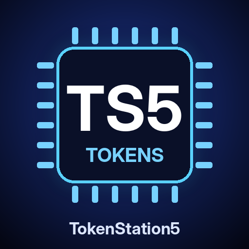

# TokenStation5

### The PS5 was built to push pixels. We're teaching it to push tokens.

Your PS5 as a private AI assistant. Talk to it with the controller, chat with
it on the TV, or plug it into the coding tools and chat apps you already use,
at home or away with Tailscale. No cloud, no subscription, and your
conversations stay at home.

---

## Two editions, one app

| | PS5 title | Linux |
| --- | --- | --- |
| Runs on | A jailbroken PS5 (firmware 13.60 or lower), from the [Prospero Store](https://github.com/darkxex/ProsperoStore) | A PS5 running Linux, or any Linux PC with a Vulkan GPU |
| Memory for models | 11.4 GiB: up to 12B models | About 13 GiB on a PS5: up to 14B models |
| Extras | | Fan, clock and compute-unit control; `.deb`, `.rpm`, Arch and portable packages |
| Install | [Install on PS5](https://github.com/ThatRetiredDude/TokenStation5/wiki/Install-on-PS5-(Prospero-Store)) | [Install on Linux](https://github.com/ThatRetiredDude/TokenStation5/wiki/Install-on-Linux) |

Both are the same code and the same engine. The **[wiki](https://github.com/ThatRetiredDude/TokenStation5/wiki)**
is the user guide: installing, models, connecting apps, Tailscale, web
search, the PS5 hardware controls on Linux, benchmarks and troubleshooting.

## What you get

- **Talk to it.** Hold R1 on the DualSense, ask out loud, let go. Speech
  recognition and the voice that reads the reply both run on the PS5 itself.
- **Chat on the TV**, with the on-screen keyboard or a USB or Bluetooth one.
  Replies stream in as they're written.
- **An OpenAI-compatible API** on your network. Kilo Code, Continue, Cline,
  aider, opencode, Open WebUI or your own scripts point at the PS5's address
  and get a local coding model with no per-token bill. Tool calling included.
- **A key for each app**, made on the TV, and a Home page that shows what
  each app used.
- **Away from home with Tailscale.** The PS5 joins your tailnet as a device
  of its own; nothing to open on the router.
- **Answers from the web**, with a free Tavily key typed on the console. Only
  the search words leave the house.
- **Models that are checked on the real hardware.** Qwen 2.5 Coder 7B for
  code, Qwen 3 8B and Llama 3.1 8B for chat, Gemma 3 12B and Mistral Nemo 12B
  when you want bigger, Llama 3.2 3B when you want speed, each with the
  sampling settings that did best on the PS5. The Models page downloads
  them, and searches Hugging Face for others that fit.
- **Fast enough to use.** On the console, Qwen 2.5 Coder 7B writes about
  **70 tokens a second** and reads prompts at almost **500 a second**; Llama
  3.2 3B writes over **130**. On Linux on the same PS5, Coder 7B does 564 / 73.
  All the numbers: [Benchmarks](https://github.com/ThatRetiredDude/TokenStation5/wiki/Benchmarks).
- **Free for individuals and small businesses.** See [Licensing](#licensing).

> [!WARNING]
> The jailbreak's own FTP and payload ports have no password, so anyone on
> your network can read the title's files, keys included. Keep the PS5 on a
> network you trust, turn on Settings > Require a key, and never forward
> port 8081 on your router: use Tailscale.

## Under the hood: ts5

Everything above runs on **ts5**, the project's own inference engine,
written from scratch in C++17 and GLSL for this one GPU: an RDNA 2 part with
36 compute units, 16 GB of unified GDDR6 and 448 GB/s of bandwidth. Generic
engines leave most of it idle, because the console's driver lacks the matrix
instructions their Vulkan paths are tuned for.

ts5 is not a fork, a wrapper or a rebrand of llama.cpp:

- **Vulkan compute kernels** of its own for matmul, attention, RoPE, RMSNorm
  and SwiGLU. They read quantized weights straight from the GGUF block layout
  and dequantize in-register.
- **A GGUF loader** that reads the file into GPU memory with no staging copy
  on unified-memory hardware.
- **Tokenizers** (byte-level BPE and SentencePiece), token-for-token
  identical to the reference implementations.
- **An OpenAI-compatible server** with streaming, tool calling, prompt-prefix
  caching and per-app keys.
- **Speculative decoding**: drafts looked up in the prompt, or from a small
  helper model, verified in one batched pass with byte-identical output, and
  an adaptive policy that stops drafting where nothing is accepted.
- **Checked, not vibes.** Every kernel is compared against an independent
  fp32 CPU implementation (logits within about 1e-4 at every position, on
  every quant type and architecture) and against llama.cpp on unquantized
  models. The same check runs on the console as the Models page's GPU check.
- **Small footprint.** The engine builds with a C++17 compiler, the Vulkan
  headers and glslang. The only third-party code it links is Mbed TLS and the
  Mozilla CA bundle, for HTTPS. Its GGUF and quantization block code follows
  ggml's reference implementation; see [NOTICE.md](NOTICE.md).

Models: Llama 3.x, Mistral and Mistral Nemo, Qwen 2.5, Qwen 3, Gemma 3,
and (Linux) Gemma 4. Quants: F32, F16, Q8_0, Q6_K, Q5_K_M, Q4_K_M, Q4_0,
Q4_1, Q5_0, Q5_1. The design is in [engine/DESIGN.md](engine/DESIGN.md).

## Status

| | |
| --- | --- |
| PS5 title | ✅ On the Prospero Store as **TokenStation5** (`PPSA99555`), release 01.004.001 |
| Linux | 🔨 Packages at the [`linux-latest`](https://github.com/ThatRetiredDude/TokenStation5/releases/tag/linux-latest) pre-release; tested on a PS5 with Debian 13, and in CI on Debian 12/13, Ubuntu, Fedora and Arch |
| Engine | ✅ GPU output matches the CPU reference on every checked model, on the console's driver and on RADV |
| Kernel tuning | 🔨 Ongoing; prompts read 13 to 16 times faster than the first console build |

## Repo map

- [engine/](engine/): ts5 source, shaders, tests, [design](engine/DESIGN.md)
- [ps5/](ps5/): the PS5 title: dashboard, voice, Tailscale client, build and packaging
- `linux/` (on the [`linux-package`](https://github.com/ThatRetiredDude/TokenStation5/tree/linux-package) branch): the Linux app, packages and PS5 hardware tools
- [scripts/](scripts/): console deploy, model fetch and benchmark tools
- [docs/STORE.md](docs/STORE.md): publishing a release to the Prospero Store
- [docs/FEASIBILITY.md](docs/FEASIBILITY.md): hardware, memory budget, risks
- [models.tsv](models.tsv): the model lineup and the context each one gets

Building any of it: [Building from source](https://github.com/ThatRetiredDude/TokenStation5/wiki/Building-from-source).

## Support development

If TokenStation5 is useful to you, tips are welcome and help fund more kernel
tuning and new models. Crypto only for now:

| Chain | Address | Scan |
| --- | --- | :---: |
| ₿ Bitcoin | `bc1qa5kevv33wq5t4sjckqe32h5hcwyymp767tfhz9` |  |
| Ξ Ethereum | `0x5976376b0c2125655e01d0a7758c744c43fb6d93` |  |
| ◎ Solana | `u5zcwMcmrn7qAN4zUJzLhpLDQv81qtFDfZR1ohCrMs9` |  |

Double-check the address against this page before sending. Crypto transfers
can't be reversed.

## Licensing

- **The engine, scripts, docs and Linux packaging:**
  [PolyForm Small Business 1.0.0](LICENSE.md). Free for individuals and for
  companies under 100 people and about $1M in revenue; larger companies need
  a commercial license.
- **The PS5 title and the Linux app** (`ps5/`, `payloads/` and the built
  programs): [GPL-3.0-or-later](ps5/LICENSE), because they link GPL-3.0 code.

[LICENSING.md](LICENSING.md) has the full map, including what the GPL means
for the engine code inside the title, and [NOTICE.md](NOTICE.md) lists the
third-party code. Model weights are downloaded by you under each model's own
license. TokenStation5 is independent and not affiliated with or endorsed by
Sony Interactive Entertainment, Tailscale Inc. or any model maker.
