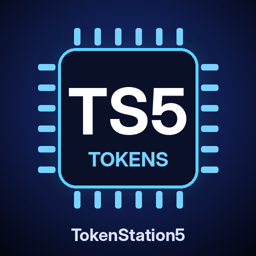

<div align="center">



# 🎮 TokenStation5

### The PS5 was built to push pixels. We're teaching it to push tokens.

A jailbroken PS5, turned into a local AI endpoint: quantized LLMs running on the console's GPU, served to your home network over an **OpenAI-compatible API**. No cloud, no subscription, no data leaving the house. It runs on **ts5** — our own inference engine, written from scratch for this one GPU.

[](https://github.com/darkxex/ProsperoStore)
[](LICENSING.md)
[](https://github.com/ThatRetiredDude/TokenStation5/stargazers)


</div>

---

## ts5: not llama.cpp

ts5 is not a fork, a wrapper or a rebrand of llama.cpp. Every layer is ours:

- **Vulkan compute kernels:** our own matmul, attention, RoPE, RMSNorm and
  SwiGLU shaders. They read quantized weights straight from GGUF block layout
  and dequantize them in-register.
- **GGUF loader:** reads the file into GPU memory, with no staging copy on
  unified-memory hardware like the PS5.
- **Tokenizers:** byte-level BPE and SentencePiece, token-for-token identical
  to the reference implementation.
- **OpenAI-compatible server:** chat completions with streaming, prompt-prefix
  caching, and llama-server-style timing stats.
- **Speculative decoding:** drafts looked up in the prompt, verified in one
  batched pass by kernels built for it, with byte-identical output and an
  adaptive policy that stops drafting where nothing is accepted.
- **Zero third-party code:** the build needs a C++17 compiler, the Vulkan
  headers and glslang, and nothing else.

### Why build our own

The PS5's GPU is an RDNA 2 part with 36 compute units, 16 GB of unified GDDR6
and 448 GB/s of bandwidth. That's real hardware, and generic engines leave most
of it idle. The existing llama.cpp port reads prompts at roughly 13% of the
GPU's fp16 throughput, because the console's driver lacks the matrix
instructions llama.cpp's Vulkan path is tuned for.

ts5 is built around this one GPU's constraints instead of around every GPU's:
- batches split to stay under the console driver's 10-second watchdog (done)
- weights loaded straight into the GPU's 11.4 GiB heap with no staging copy (done)
- kernels tuned to RDNA 2 wavefronts and packed fp16 math (done, still being tuned)

The full plan is in [engine/DESIGN.md](engine/DESIGN.md).

## Status

| | |
| --- | --- |
| Engine core | ✅ Working on Linux and on the PS5. Logits match the reference at every position, on every quant type |
| Models | ✅ Qwen 2.5, Qwen 2.5 Coder, Qwen 3, Llama, Mistral, Mistral Nemo |
| Quants | ✅ F32, F16, Q8_0, Q4_0, Q4_1, Q5_0, Q5_1, Q4_K_M, Q5_K_M |
| OpenAI API | ✅ `/v1/chat/completions` (streaming), `/v1/completions`, `/v1/models` |
| PS5 title | ✅ Runs on a real PS5 as **TokenStation5** (`PPSA99555`). The GPU check passes on the console, and the API serves the home network |
| TV dashboard | ✅ Pick, check, benchmark and serve models with the controller, on the TV |
| PS5 kernel tuning | 🔨 Ongoing: prompts read 13 to 16 times faster and generation about 3.5 times faster than the first console build; the new attention doubled generation again at 16k+ context |
| Speculative decoding | ✅ Code editing with Coder 7B runs at 102 tok/s against 64 with drafting off, byte-identical output; free chat stays within 4% |
| Gemma 3, Qwen 3.5, Gemma 4 | 📋 Planned |

## On the console today

Measured on a PS5 at 8k context. Numbers in brackets are the build that first
ran there, before any kernel tuning:

| Model | GPU check | Prompt tok/s | Generation tok/s | Load | GPU memory |
| --- | :---: | ---: | ---: | ---: | ---: |
| Qwen 2.5 0.5B Q8_0 | ✅ | **4636** | **233** | ~0.5 s | |
| Llama 3.2 3B Q4_K_M | ✅ | **1016** (78) | **131** (36) | ~1 s | 1.9 + 0.9 GiB |
| Qwen 2.5 Coder 7B Q4_K_M | ✅ | **483** (31) | **70** (21) | 2.3 s | 4.4 + 0.4 GiB |
| Qwen 3 8B Q4_K_M | ✅ | **429** (29) | **68** (19) | ~2.4 s | 4.7 + 1.1 GiB |
| Llama 3.1 8B Q4_K_M | ✅ | **428** (28.5) | **70** (19.7) | ~2.3 s | 4.6 + 1.0 GiB |

The GPU check runs the same prompt through the console's GPU and through
ts5's CPU reference, and compares the logits at every position. With a
512-token prompt, all four models pick the same top word as the CPU at every
one of the 512 positions, because prompts are summed in 32-bit (16-bit sums,
`TS5_MMB_F16=1`, read prompts 9 to 14% faster but put Llama 3.2 3B over the
check's bar). The first check of a model saves the CPU's answers next to it,
so later checks run only the GPU and take about a second. Prompt and generation speeds are `ts5 bench`
(512-token prompt, 128 generated tokens). Load is how long a model takes to
get ready: the loader reads at 2 GB/s, measured on Coder 7B (2.3 s, down
from 51); the other models' times scale with their size. GPU memory is
weights plus the f16 KV cache.

The tuned kernels read prompts 13 to 16 times faster than the first console
build and generate about 3.5 times faster, with the same answers. Long
contexts gained the most from the new attention: after a 16,384-token prompt,
Qwen 2.5 Coder 7B reads at 387 tok/s and generates at 50, where generating
at that depth used to run at 23. On Llama 3.2 3B, where the llama.cpp port
used to generate half again as fast as ts5, ts5 is now ahead (131 tok/s to
the port's 124). Speculative decoding adds its gain on top of all of that:
editing code with Coder 7B runs at 102 tok/s against 64 with drafting off,
with byte-identical output, and free chat stays within 4% either way
because drafting backs off where nothing is accepted.

[PS5LM Plus](https://github.com/abhi245y/PS5LM), a llama.cpp port, stays on
the console as the baseline ts5 has to beat.

## Quick start

```sh
# build (any Linux box with a Vulkan driver)
sudo apt install glslang-tools libvulkan-dev mesa-vulkan-drivers
cmake -S engine -B engine/build && cmake --build engine/build -j

# serve an OpenAI-compatible API
engine/build/ts5 serve -m qwen2.5-coder-7b-instruct-q4_k_m.gguf --port 8081

# or chat from the terminal
engine/build/ts5 run -m model.gguf --chat -p "Write a haiku about a PS5"

# measure prompt and generation speed
engine/build/ts5 bench -m model.gguf

# download a model over HTTPS, checking its hash; a stopped download goes on where it left off
engine/build/ts5 fetch https://huggingface.co/REPO/resolve/main/model.gguf model.gguf --sha256 HEX
```

Then point any OpenAI-compatible client at `http://<host>:8081/v1`: Open
WebUI, Continue, opencode, aider, or your own scripts.

## On the PS5

ts5 ships as its own PS5 title, **TokenStation5** (title ID `PPSA99555`, a
homebrew ID that no store game uses). It's the same engine, linked against
Mihawk-99's RADV port so it runs on the console's GPU.

```sh
ps5/setup.sh && ps5/build.sh        # or download the title from the latest CI run
export PS5_HOST=192.168.1.50
scripts/ts5-ps5.sh install          # to /data/homebrew/PPSA99555
scripts/ts5-ps5.sh fetch qwen25-coder-7b
# launch TokenStation5 from the home screen
```

Publishing to the [Prospero Store](https://github.com/darkxex/ProsperoStore)
is set up: push a version tag and the [`release`](.github/workflows/release.yml)
workflow builds and attaches `PPSA99555.zip` plus a ready-to-submit catalog
record. See [docs/STORE.md](docs/STORE.md) for the submission steps.

The TV shows a dashboard. It lists the models on the console with their size,
quant, GPU memory and results, and suggests starter models that aren't there
yet. Use the controller to pick one, then:

- ✕ serves it on the API;
- □ runs the GPU check;
- △ runs the speed test;
- ○ stops serving.

Everything the controller does is also one command from the PC. All of it is in
[ps5/README.md](ps5/README.md).

## Proven correct, not vibes

Every kernel is checked against an independent fp32 CPU implementation and
against llama.cpp itself:

- Logits at every position match the CPU reference to about 1e-4 across F32,
  F16, Q8_0, Q4_0, Q4_1, Q5_0, Q5_1, Q4_K_M and Q5_K_M, for all three
  architectures, and match llama.cpp to 2e-4 on unquantized models.
- KV-cache reuse across calls and 300-token prompts are covered.
- The tokenizer matches `llama-tokenize` on 15 tricky strings (code,
  contractions, CJK, emoji, chat special tokens) for Qwen, Llama 3 and
  SentencePiece vocabularies.
- The same check runs on the console itself (`ts5 check`, the dashboard's □).
  Qwen 2.5 Coder 7B on the PS5's GPU gives the CPU's top token at all 8
  positions, with logits within 0.15% of the largest.
- CI runs the suite on every pull request and every push to main. It also
  builds the PS5 title, and runs the title's own code on Linux, driving the
  dashboard the way a user would.

```sh
engine/tests/run.sh                          # Vulkan vs the CPU reference
LLAMA_CPP=~/llama.cpp engine/tests/run.sh    # plus llama.cpp and tokenizer checks
```

## Models that fit

Memory is an 11.44 GiB GPU heap on the console. Measured numbers are in
[On the console today](#on-the-console-today).

| Model | Quant | Size | Role |
| --- | --- | ---: | --- |
| Qwen 2.5 0.5B | Q8_0 | ~0.6 GiB | quick GPU test |
| Llama 3.2 3B | Q4_K_M | ~1.9 GiB | small and fast; the llama.cpp port's benchmark |
| Qwen 2.5 Coder 7B | Q4_K_M | ~4.4 GiB | coding endpoint |
| Qwen 3 8B | Q4_K_M | ~4.7 GiB | general chat, thinking mode |
| Llama 3.1 8B | Q4_K_M | ~4.6 GiB | general chat |
| Mistral Nemo 12B | Q4_K_M | ~7.0 GiB | long-form writing |
| Gemma 3 12B | Q4_K_M | ~6.8 GiB | planned |
| Qwen 3.5 4B / 9B | Q4_K_M | ~2.7 / 5.3 GiB | planned |
| Gemma 4 E4B | Q4_0 | ~4.3 GiB | planned |

## Repo map

- [engine/](engine/): ts5 source, shaders, tests, [design](engine/DESIGN.md)
- [ps5/](ps5/): the PS5 title: build, packaging, console control
- [docs/ROADMAP.md](docs/ROADMAP.md): milestones
- [docs/FEASIBILITY.md](docs/FEASIBILITY.md): hardware, memory budget, risks
- [docs/WEB_SEARCH.md](docs/WEB_SEARCH.md): web search with a Tavily key, and tool calling
- [scripts/](scripts/): console deploy, model fetch and benchmark tools
- [models.tsv](models.tsv): the model lineup and the context each one gets

## The baseline: PS5LM Plus

On the console: jailbreak (firmware 13.60 or lower), then load ShadowMountPlus,
ftpsrv (2121) and elfldr (9021). On a PC on the same network:

```sh
export PS5_HOST=192.168.1.50
scripts/install-ps5lm.sh                # baseline app, sha256 checked
scripts/fetch-models.sh qwen25-coder-7b # Hugging Face -> PC -> console over FTP
scripts/load-model.sh Qwen2.5-Coder-7B-Instruct-Q4_K_M.gguf
python3 scripts/bench.py                # results land in bench/results.md
```

`bench.py` speaks plain OpenAI API, so the same command benchmarks ts5 on the
console.

## Safety

A jailbroken console's API, FTP and payload ports have no authentication.
Keep it on a network you trust.

## Licensing

- **Everything in this repository, unless [LICENSING.md](LICENSING.md) says
  otherwise:** [PolyForm Small Business 1.0.0](LICENSE.md). Free for
  individuals and for companies under 100 people and about $1M in revenue;
  larger companies need a commercial license.
- **`ps5/`, `payloads/` and the built PS5 title:**
  [GPL-3.0-or-later](ps5/LICENSE), because the title links PS5_Vulkan's
  GPL-3.0 code.

[LICENSING.md](LICENSING.md) has the full map, including what the GPL means
for the engine code inside the PS5 title, and
[NOTICE.md](NOTICE.md) lists the third-party code.
