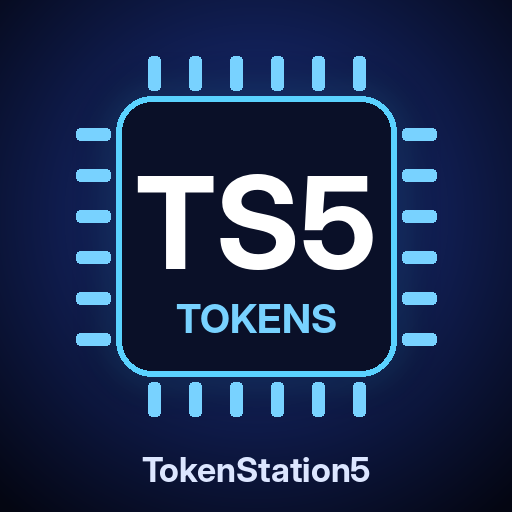

<div align="center">



# 🎮 TokenStation5

### The PS5 was built to push pixels. We're teaching it to push tokens.

A private AI assistant that runs on your own hardware: a jailbroken PS5, a PS5 running Linux, or any Linux PC with a Vulkan GPU. Chat on the TV, in a terminal or on your phone, talk to it with the controller, and plug it into the coding tools and chat apps you already use, at home or away with Tailscale. No cloud, no subscription, and your conversations stay at home.

[](https://github.com/ThatRetiredDude/TokenStation5/releases/tag/linux-v1.3.1)
[](https://github.com/darkxex/ProsperoStore)

[](https://github.com/ThatRetiredDude/TokenStation5/releases)
[](https://github.com/ThatRetiredDude/TokenStation5/stargazers)
[](LICENSING.md)
[](https://github.com/ThatRetiredDude/TokenStation5/wiki)


**[🐧 Install on Linux](#-tokenstation-for-linux-131)** · **[🎮 Install on a PS5](#-the-ps5-title)** · **[📖 Wiki](https://github.com/ThatRetiredDude/TokenStation5/wiki)** · **[🧠 Models](#-models)** · **[📦 Releases](https://github.com/ThatRetiredDude/TokenStation5/releases)**

</div>

---

> [!TIP]
> **TokenStation for Linux 1.3.1 is out.** It runs on a PS5 running Linux and on
> any Linux PC with a Vulkan GPU, with everything the PS5 title does plus a
> terminal app, a chat page for your phone, users, and a model that can use
> tools. [Jump to the install](#-tokenstation-for-linux-131).

## Two editions, one engine

| | 🐧 **Linux** | 🎮 **PS5 title** |
| --- | --- | --- |
| **Runs on** | A PS5 running Linux, or any x86-64 Linux PC with a Vulkan GPU | A jailbroken PS5 on firmware 13.60 or lower |
| **Latest** | [1.3.1](https://github.com/ThatRetiredDude/TokenStation5/releases/tag/linux-v1.3.1) (2026-11-18) | [01.004.001](https://github.com/ThatRetiredDude/TokenStation5/releases/tag/01.004.001) (2026-10-28) |
| **Install** | One command: `.deb`, `.rpm`, Arch package or portable build | The Prospero Store, or the title's zip |
| **Memory for models** | About 12 to 13 GiB on a PS5, so 14B models fit | 11.4 GiB, up to 12B models |
| **Ways to use it** | TV dashboard, desktop app, terminal app over SSH, browser terminal, phone chat page, API | TV dashboard, voice, API |
| **Extras** | Users, phone controls, notifications, tools (web, browser, terminal sandbox, files, GitHub, MCP), fan and clock control | Runs on the console itself, no Linux needed |
| **License** | PolyForm Small Business | GPL-3.0-or-later |

Both are built from the same code around **ts5**, our own inference engine, written from scratch for the PS5's GPU.

---

## 🐧 TokenStation for Linux 1.3.1

### Install

Pick **one** line, the one for your system. Each always fetches the newest
build, so run it again to update (or type `/update` in the terminal app).
Your models, chats, keys and settings stay where they are.

```sh
# Debian 12 or 13, Ubuntu
curl -LO https://github.com/ThatRetiredDude/TokenStation5/releases/download/linux-latest/tokenstation_latest_amd64.deb && sudo apt install ./tokenstation_latest_amd64.deb

# Fedora
sudo dnf install https://github.com/ThatRetiredDude/TokenStation5/releases/download/linux-latest/tokenstation-latest.x86_64.rpm

# Arch
curl -LO https://github.com/ThatRetiredDude/TokenStation5/releases/download/linux-latest/tokenstation-latest-x86_64.pkg.tar.zst && sudo pacman -U ./tokenstation-latest-x86_64.pkg.tar.zst

# Bazzite, SteamOS and anything else (installs into your home folder; run it as yourself, not with sudo)
curl -L https://github.com/ThatRetiredDude/TokenStation5/releases/download/linux-latest/tokenstation-latest-linux-amd64.tar.gz | tar xz && cd tokenstation-linux-amd64 && ./install.sh
```

Prefer a fixed version? The same four files are attached to every numbered
release, for example
[linux-v1.3.1](https://github.com/ThatRetiredDude/TokenStation5/releases/tag/linux-v1.3.1).

### Then

1. **On a PS5 only:** restart once (`sudo reboot`, then run the Linux loader
   again). The install raises the GPU's memory limit, and that takes hold at boot.
2. **Start it.** With a desktop, open **TokenStation5** from the app menu. Over
   SSH, or with no desktop, type `ts5-tui`.
3. **Get a model and chat.** In the terminal app type `/download qwen3-8b` and
   press Enter (about 5 GB; its helper model follows by itself), select it on
   the Models page (F2), press Enter to load it, and chat on F1. In the desktop
   app: Models, Qwen3 8B, download, then Chat.

That's it. The full five-step guide, with checks and what to do when something
looks wrong, is the wiki's
**[Install on Linux](https://github.com/ThatRetiredDude/TokenStation5/wiki/Install-on-Linux)**.

> [!IMPORTANT]
> **On a PS5 running Linux** you need Linux on the console first (from
> [ps5-linux-loader](https://github.com/rmuxwashere/ps5-linux-loader), firmware
> 3.00 to 13.60) and **Mesa 25.3 or newer** for its GPU: Debian 13 with
> `trixie-backports`, Fedora, Ubuntu 26.04 or Bazzite. Debian 12's Mesa doesn't
> know the chip. Check with `vulkaninfo --summary`: you want **RADV GFX1013**.
> TokenStation5 doesn't boot or unlock anything itself.

### What the Linux edition adds

- **⌨️ A terminal app, `ts5-tui`.** Chat, download, switch and tune models, and
  watch GPU memory, temperatures and the fan live, over SSH or in a browser.
- **🛠️ A model that uses tools.** Web search with no key (DuckDuckGo, Google
  through Chromium, Grokipedia or Wikipedia), a real browser, files, GitHub
  (connected with a QR code), other programs' tools over MCP, and a terminal
  whose commands run in a sandbox with a Debian system of its own, where the
  model can `apt install` what it needs without touching yours. Every tool has
  its own off, ask or allow switch. Long tasks keep going when the chat fills up.
- **📱 Your phone.** Scan a QR code and a chat page opens, signed in, at home or
  on mobile data through Tailscale. Add it to the Home Screen as an app, get a
  notification when an answer finishes, and load models, set the fan or manage
  users from Controls.
- **👥 Users.** Accounts for family and friends, with their own keys and chats,
  and only what you allow (models, web search, tokens a day).
- **🧠 Bigger and newer models.** 14B models fit on a PS5 with Linux, plus Qwen
  3.5 with up to 262k tokens of context, Gemma 4, and two-bit Bonsai models up
  to 27B.
- **🌡️ The hardware is yours.** Fan modes, clock boost, and 36, 38 or 40 GPU
  compute units on a PS5; all 8 CPU cores.
- **🖥️ Any Linux PC.** The same app on a desktop with any Vulkan GPU.

What changed in each version is in
[the release notes](https://github.com/ThatRetiredDude/TokenStation5/tree/linux-package/linux/release-notes).
Found a bug? Type `/feedback` in `ts5-tui`, or
[open an issue](https://github.com/ThatRetiredDude/TokenStation5/issues/new)
with your distribution, the GPU line from `vulkaninfo --summary`, and what
happened.

---

## What you get

### 🎙️ Talk to it

Hold **R1** on the DualSense, ask your question out loud, and let go. Your
speech becomes text, the model answers, and the reply is read back in a natural
voice on the TV or the controller's speaker. Speech recognition and the voice
both run on the machine itself, so nothing you say goes to a server.

### 💬 Chat anywhere

A full chat screen on the TV, with the on-screen keyboard or a USB or Bluetooth
keyboard. On Linux, also in the terminal app, in a browser terminal, and on a
chat page made for phones. Replies stream in as they're written, thinking
included.

### 🧑‍💻 A coding assistant for your editor

TokenStation5 serves the API that OpenAI-compatible apps already speak, so it
drops straight into Kilo Code, Continue, Cline, aider, opencode, Open WebUI or
your own scripts. Point them at `http://<address>:8081/v1` and you have a local
coding model for every machine on your network, with no per-token bill. Setup
for each is in
[Connecting apps](https://github.com/ThatRetiredDude/TokenStation5/wiki/Connecting-apps).

### 🔑 A key for each app

Make a key for each app, named after it, and turn on Require a key: apps then
need one, the way they'd use an OpenAI key, and Home shows each app's usage
under its name. Turn a key off to shut that app out without removing it.

### 🌍 Away from home with Tailscale

Turn on Tailscale and scan the code with your phone: TokenStation5 joins your
tailnet as a device of its own, with nothing to set up on the router and
nothing opened to the internet. Your phone, tablet or laptop then reaches it
from anywhere. On Linux it can get its own HTTPS certificate, and you can share
it with someone else's tailnet.

### ⚡ Fast enough to actually use

On a PS5 with Linux, Qwen3 8B writes about **72 tokens a second** (a token is
roughly three quarters of a word) and reads prompts at about **850 a second**;
Qwen3 14B, the best all-rounder, writes about **41 a second**. Small helper
models that draft ahead make writing faster still, with exactly the same text.
Models are ready a couple of seconds after you pick them. All the numbers are in
[Models](#-models) and the wiki's
[Benchmarks](https://github.com/ThatRetiredDude/TokenStation5/wiki/Benchmarks).

### 🌐 Answers from the web

The model looks things up when a question needs fresh information, then answers
with links to its sources. Add a free [Tavily](https://tavily.com) key, or on
Linux use the keyless search. Only the search words leave the house.

### 📺 Run it all from the couch

Everything works with the controller: **Home** shows how your apps used it,
like an AI provider's usage page; **Models** lists what's there and what fits,
downloads new ones (checked against their hash, resumed if stopped), searches
Hugging Face, and runs a speed test or a correctness check with one button;
**Chat**, **Settings** and **Logs** do what they say.

### 🔓 Free for personal use

Free for individuals and small businesses. See [Licensing](#licensing).

---

## 🧠 Models

Every model below ran on a PS5 with Linux (40 compute units, GPU memory raised)
and passed the check against ts5's CPU reference. The terminal app downloads
each one with `/download <key>`, with its helper right after it. Speeds are
tokens a second, one request at a time, without a helper. Files are Q4_K_M
unless named.

| Model | `/download` key | Good for | File | Prompt | Writing | Context | Helper |
| --- | --- | --- | ---: | ---: | ---: | ---: | --- |
| Qwen3 14B | `qwen3-14b` | Best all-rounder; can think first | 9.0 GB | ~490 | 41 | 32k | Qwen3 0.6B |
| Qwen3.5 9B (DeepSeek-V4-Pro heretic) | `qwen35-9b` | Very long documents (10/10 facts at 225k) | 5.6 GB | ~826 | 67 | 256k | none |
| Qwen3.8 9B (distill) | `qwen38-9b` | Long documents, newer training; thinks, calls tools | 5.8 GB | ~651 | 67 | 256k | none |
| DeepSeek R1 Distill Qwen 14B | `deepseek-r1-14b` | Math, logic, puzzles; thinks out loud | 9.0 GB | ~490 | 38-41 | 32k | Qwen3 0.6B |
| Qwen3 8B | `qwen3-8b` | Fast chat, thinking, tools | 5.0 GB | ~850 | 72 | 32k | Qwen3 0.6B |
| Llama 3.1 8B Instruct | `llama31-8b` | Fast chat with a long memory (10/10 at 111k) | 4.9 GB | ~850 | 74 | 128k | Llama 3.2 1B |
| Qwen 2.5 Coder 7B Instruct | `qwen25-coder-7b` | Coding, fastest | 4.7 GB | ~960 | 77 | 32k | Qwen3 0.6B |
| Qwen 2.5 Coder 14B Instruct | `qwen25-coder-14b` | Coding, stronger | 9.0 GB | | ~28-30 | 32k | Qwen3 0.6B |
| Llama 3.2 3B Instruct | `llama32-3b` | Quick answers | 2.0 GB | ~1,290 | 145 | 128k | Llama 3.2 1B |
| Gemma 3 12B | `gemma3-12b` | General chat | 7.3 GB | ~406 | 45 | 64k | by tuning |
| Gemma 4 12B | `gemma4-12b` | General chat | 7.7 GB | ~394 | 43 | 128k | by tuning |
| Ternary Bonsai 2 27B (Q2_0) | `bonsai2-27b` | The biggest that fits; thinks, calls tools | 7.6 GB | ~229 | 23 | 150k | none |
| Ternary Bonsai 2 9B (Q2_0) | `bonsai2-9b` | Small file, long memory | 2.6 GB | ~740 | 59 | 256k | none |
| Ternary Bonsai 2 4B (Q2_0) | `bonsai2-4b` | Fastest, smallest download | 1.2 GB | ~1,380 | 119 | 256k | none |

Helpers draft a few words ahead and the big model checks them: the same text,
written faster (Qwen3 14B goes from about 41 to 56 tok/s on chat). Qwen 2.5
Coder 14B was measured on long prompts only. Long-document scores count 10
facts hidden in a document. Each model's pinned download and hash, and the
helpers, are in
[Models tested on PS5](https://github.com/ThatRetiredDude/TokenStation5/wiki/Models-tested-on-PS5).

**On the PS5 title** the GPU gets 11.44 GiB, so a 12B at Q4_K_M is the practical
ceiling. Its Models page offers Llama 3.2 3B, Qwen 2.5 Coder 7B, Qwen 3 8B and
Llama 3.1 8B, and Gemma 3 12B and Mistral Nemo 12B are checked there too:

| Model (PS5 title) | GPU check | Prompt tok/s | Generation tok/s | Load | GPU memory |
| --- | :---: | ---: | ---: | ---: | ---: |
| Llama 3.2 3B Q4_K_M | ✅ | **1016** | **131** | ~1 s | 1.9 + 0.9 GiB |
| Qwen 2.5 Coder 7B Q4_K_M | ✅ | **483** | **70** | 2.3 s | 4.4 + 0.4 GiB |
| Qwen 3 8B Q4_K_M | ✅ | **429** | **68** | ~2.4 s | 4.7 + 1.1 GiB |
| Llama 3.1 8B Q4_K_M | ✅ | **428** | **70** | ~2.3 s | 4.6 + 1.0 GiB |
| Gemma 3 12B Q4_K_M | ✅ | **250** | **40** | ~3.5 s | 6.8 + 1.1 GiB |

`ts5 bench` with a 512-token prompt and 128 generated tokens, at 8k context.
GPU memory is weights plus the f16 KV cache. Editing code with Coder 7B runs at
102 tok/s with drafting against 64 without, with byte-identical output.

**Architectures:** Llama 3.x, Mistral and Mistral Nemo, Qwen 2.5, Qwen 3, Gemma 3,
and on Linux also Qwen 3.5, Gemma 4 (dense) and Bonsai.
**Quants:** F32, F16, Q8_0, Q6_K, Q5_K_M, Q4_K_M, Q5_0, Q5_1, Q4_0, Q4_1, and
Q2_0 on Linux. Mixture-of-experts models aren't supported yet.

---

## 🎮 The PS5 title

ts5 also ships as its own PS5 title, **TokenStation5** (title ID `PPSA99555`, a
homebrew ID that no store game uses). It's the same engine, linked against
Mihawk-99's RADV port so it runs on the console's GPU.

**What you need:** a PS5 on firmware 13.60 or lower with the jailbreak loaded,
a home network, and optionally a USB or Bluetooth keyboard.

**Install:** get it from the [Prospero Store](https://github.com/darkxex/ProsperoStore),
or from the [latest title release](https://github.com/ThatRetiredDude/TokenStation5/releases/tag/01.004.001).
Pick a model on the TV and you're running. Step by step:
[Install on PS5 (Prospero Store)](https://github.com/ThatRetiredDude/TokenStation5/wiki/Install-on-PS5-(Prospero-Store)).

The TV shows a dashboard that lists the models on the console with their size,
quant, GPU memory and results, and suggests starter models. Use the controller
to pick one, then ✕ serves it on the API, □ runs the GPU check, △ runs the speed
test, and ○ stops serving. Everything the controller does is also one command
from a PC: see [ps5/README.md](ps5/README.md).

> [!WARNING]
> The jailbreak's own FTP and payload ports have no password, so anyone on
> your network can read the title's files, keys included. Keep the PS5 on a
> network you trust. The API itself asks for a key once Settings > Require a
> key is on.

> [!NOTE]
> A store update keeps your settings, keys and chats, and the first start of
> the new version brings back the models you downloaded, through the
> jailbreak's FTP server. Start the title once after each update: the store
> keeps the old models only until the next one. Without the FTP server, put
> them back from a computer (Settings > Instructions > Add models from a
> computer) or download them again.

### Building the title yourself

```sh
ps5/setup.sh && ps5/build.sh        # or download the title from the latest CI run
export PS5_HOST=192.168.1.50
scripts/ts5-ps5.sh install          # to /data/homebrew/PPSA99555
scripts/ts5-ps5.sh fetch qwen25-coder-7b
# launch TokenStation5 from the home screen
```

Publishing to the Prospero Store is set up: push a version tag and the
[`release`](.github/workflows/release.yml) workflow builds and attaches
`PPSA99555.zip` plus a ready-to-submit catalog record. See
[docs/STORE.md](docs/STORE.md).

---

## Under the hood

### ts5: not llama.cpp

ts5 is not a fork, a wrapper or a rebrand of llama.cpp. Every layer is ours:

- **Vulkan compute kernels:** our own matmul, attention, RoPE, RMSNorm and
  SwiGLU shaders. They read quantized weights straight from GGUF block layout
  and dequantize them in-register.
- **GGUF loader:** reads the file into GPU memory, with no staging copy on
  unified-memory hardware like the PS5.
- **Tokenizers:** byte-level BPE and SentencePiece, token-for-token identical
  to the reference implementation.
- **OpenAI-compatible server:** chat completions with streaming, tool calls,
  prompt-prefix caching, and llama-server-style timing stats.
- **Speculative decoding:** drafts from a small helper model or looked up in
  the prompt, verified in one batched pass, with byte-identical output and an
  adaptive policy that stops drafting where nothing is accepted.
- **Long context:** 8-bit and 4-bit KV cache and YaRN, so the long-memory
  models get their full window on a PS5.
- **Almost no third-party code:** the engine needs a C++17 compiler, the Vulkan
  headers and glslang; the Linux binary adds Mbed TLS for HTTPS
  ([NOTICE.md](NOTICE.md)).

### Why build our own

The PS5's GPU is an RDNA 2 part with 36 compute units, 16 GB of unified GDDR6
and 448 GB/s of bandwidth. That's real hardware, and generic engines leave most
of it idle. The existing llama.cpp port reads prompts at roughly 13% of the
GPU's fp16 throughput, because the console's driver lacks the matrix
instructions llama.cpp's Vulkan path is tuned for.

ts5 is built around this one GPU's constraints instead of around every GPU's:
batches split to stay under the console driver's 10-second watchdog, weights
loaded straight into the GPU's heap with no staging copy, and kernels tuned to
RDNA 2 wavefronts and packed fp16 math. The tuned kernels read prompts 13 to 16
times faster than the first console build and generate about 3.5 times faster,
with the same answers. The full plan is in [engine/DESIGN.md](engine/DESIGN.md).

### Proven correct, not vibes

Every kernel is checked against an independent fp32 CPU implementation and
against llama.cpp itself:

- Logits at every position match the CPU reference to about 1e-4 on every quant
  type and architecture ts5 runs, and match llama.cpp to 2e-4 on unquantized
  models.
- The tokenizer matches `llama-tokenize` on tricky strings (code, contractions,
  CJK, emoji, chat special tokens) for Qwen, Llama 3 and SentencePiece
  vocabularies.
- The same check runs on the machine itself (`ts5 check`, the dashboard's □):
  the GPU's answers against the CPU's, position by position. The first check
  saves the CPU's answers, so later checks take about a second.
- Every change is checked on a real PS5 with real models before it's called
  done.

```sh
engine/tests/run.sh                          # Vulkan vs the CPU reference
LLAMA_CPP=~/llama.cpp engine/tests/run.sh    # plus llama.cpp and tokenizer checks
```

### Build the engine from source

```sh
# any Linux box with a Vulkan driver
sudo apt install glslang-tools libvulkan-dev mesa-vulkan-drivers
cmake -S engine -B engine/build && cmake --build engine/build -j

engine/build/ts5 serve -m qwen2.5-coder-7b-instruct-q4_k_m.gguf --port 8081   # OpenAI-compatible API
engine/build/ts5 run -m model.gguf --chat -p "Write a haiku about a PS5"       # chat in the terminal
engine/build/ts5 bench -m model.gguf                                           # prompt and generation speed
engine/build/ts5 fetch https://huggingface.co/REPO/resolve/main/model.gguf model.gguf --sha256 HEX
```

The Linux packages, the terminal app and the services are built from the
[`linux-package`](https://github.com/ThatRetiredDude/TokenStation5/tree/linux-package)
branch: see
[Building from source](https://github.com/ThatRetiredDude/TokenStation5/wiki/Building-from-source).

---

## Repo map

- [engine/](engine/): ts5 source, shaders, tests, [design](engine/DESIGN.md)
- [ps5/](ps5/): the PS5 title: build, packaging, console control
- [linux/ on `linux-package`](https://github.com/ThatRetiredDude/TokenStation5/tree/linux-package/linux): the Linux edition: packages, services, [release notes](https://github.com/ThatRetiredDude/TokenStation5/tree/linux-package/linux/release-notes)
- [docs/CLIENTS.md](docs/CLIENTS.md): setting up each app
- [docs/WEB_SEARCH.md](docs/WEB_SEARCH.md): web search and tool calling
- [docs/FEASIBILITY.md](docs/FEASIBILITY.md): hardware, memory budget, risks
- [docs/ROADMAP.md](docs/ROADMAP.md): the punch list
- [scripts/](scripts/): console deploy, model fetch and benchmark tools
- [models.tsv](models.tsv): the model lineup and the context each one gets
- [The wiki](https://github.com/ThatRetiredDude/TokenStation5/wiki): the user guide for both editions

## The baseline: PS5LM Plus

[PS5LM Plus](https://github.com/abhi245y/PS5LM), a llama.cpp port, stays on the
console as the baseline ts5 has to beat. On Llama 3.2 3B ts5 now generates
131 tok/s to the port's 124. To run it yourself: jailbreak (firmware 13.60 or
lower), load ShadowMountPlus, ftpsrv (2121) and elfldr (9021), then on a PC on
the same network:

```sh
export PS5_HOST=192.168.1.50
scripts/install-ps5lm.sh                # baseline app, sha256 checked
scripts/fetch-models.sh qwen25-coder-7b # Hugging Face -> PC -> console over FTP
scripts/load-model.sh Qwen2.5-Coder-7B-Instruct-Q4_K_M.gguf
python3 scripts/bench.py                # results land in bench/results.md
```

## Safety

- The API is plain HTTP on port 8081. Turn on **Require a key** and make a key
  per app; apps send it the way they send an OpenAI key.
- Never forward port 8081 on your router. Use Tailscale to reach it from
  outside: only your own devices can, and on Linux it can use HTTPS.
- On a jailbroken PS5 the jailbreak's FTP and payload ports have no password.
  Keep the console on a network you trust.
- On Linux, the model's terminal commands run in a sandbox that sees none of
  your home folder, and each tool can be set to off, ask or allow.

## Support development

If TokenStation5 is useful to you, tips are welcome and help fund more kernel
tuning and new models. Crypto only for now:

| Chain | Address | Scan |
| --- | --- | :---: |
| ₿ Bitcoin | `bc1qa5kevv33wq5t4sjckqe32h5hcwyymp767tfhz9` |  |
| Ξ Ethereum | `0x5976376b0c2125655e01d0a7758c744c43fb6d93` |  |
| ◎ Solana | `u5zcwMcmrn7qAN4zUJzLhpLDQv81qtFDfZR1ohCrMs9` |  |

Double-check the address against this page before sending: crypto transfers
can't be reversed.

## Licensing

- **Everything in this repository, unless [LICENSING.md](LICENSING.md) says
  otherwise, including the Linux edition:** [PolyForm Small Business 1.0.0](LICENSE.md).
  Free for individuals and for companies under 100 people and about $1M in
  revenue; larger companies need a commercial license.
- **`ps5/`, `payloads/` and the built PS5 title:**
  [GPL-3.0-or-later](ps5/LICENSE), because the title links PS5_Vulkan's
  GPL-3.0 code. The Linux binary links nothing GPL.

[LICENSING.md](LICENSING.md) has the full map, and [NOTICE.md](NOTICE.md) lists
the third-party code.

TokenStation5 is an independent project, not affiliated with or endorsed by
Sony Interactive Entertainment, Tailscale Inc. or any model maker.
