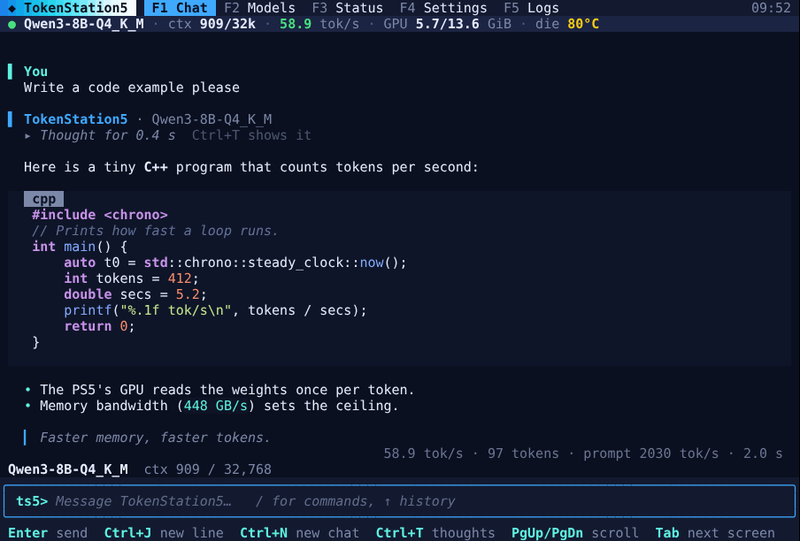
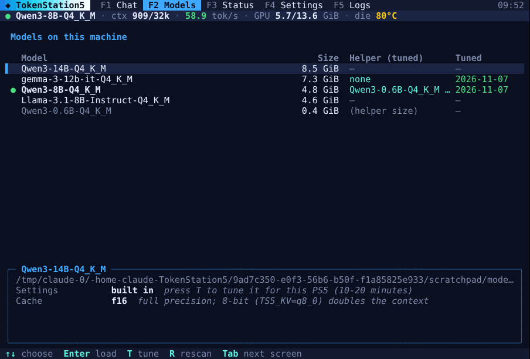

# Using the terminal app (ts5-tui)

`ts5-tui` is TokenStation5 in a terminal: a colorful, keyboard-driven app for when you SSH into the PS5, or sit at its text console. It chats with the loaded model and keeps every chat, downloads, switches, checks and tunes models, and shows the PS5's GPU memory, temperatures and fan live. Linux edition only.



It is a client of TokenStation's own API (port 8081), like any other app. It loads nothing itself and uses no GPU memory, so it can run beside the TV app or the API-only service.

> **Availability:** ts5-tui ships in the Linux packages from the [linux-latest](https://github.com/ThatRetiredDude/TokenStation5/releases/tag/linux-latest) build of 2026-11-10 on: `/usr/bin/ts5-tui` with the `.deb`, `.rpm` and Arch packages, and `~/.local/bin/ts5-tui` with the portable build. Already installed an older build? Run the [install command](Install-on-Linux#2-install-the-package) again to update.

## Start it

From your computer, SSH into the PS5, then run `ts5-tui`:

```sh
ssh ps5@<your PS5's address>
ts5-tui
```

The TokenStation title sweeps in for about a second (any key skips it), and you land in Chat.

| Command | What it does |
| --- | --- |
| `ts5-tui` | Talks to the server on this machine (`http://127.0.0.1:8081`). |
| `ts5-tui --url http://ps5.local:8081` | Talks to another TokenStation (`ps5.local` alone works too: http and port 8081 are assumed). |
| `ts5-tui --key KEY` | An API key, when the server asks for one (the TV app's **Require a key**). |
| `ts5-tui --theme Neon` | Colors: `Ocean` (default), `Neon`, `Sunset`, `Forest`, `Mono`. |
| `ts5-tui --no-intro` | Skips the opening title. |
| `ts5-tui --tmux` / `--no-tmux` | Forces its own tmux session on or off (see [tmux](#tmux-ssh-that-can-drop)). |

`TS5_URL` and `TS5_API_KEY` in the environment do the same as `--url` and `--key`.

Run it **on the PS5** (over SSH) for the whole experience. Pointed at a PS5 from another machine with `--url`, chat works, but the sensors, models and logs it shows are that machine's, and loading a model is refused: models are switched where they are served.

## The screen

```
 ◆ TokenStation5   F1 Chat  F2 Models  F3 Status  F4 Settings  F5 Logs        09:52   ← pages
 ● Qwen3-8B-Q4_K_M · helper Qwen3-0.6B to 8k · chat 909/20k · 94.4 tok/s · GPU 5.7/13.6 GiB · die 80°C   ← live bar

   (chat, or the page you picked)

 Qwen3-8B-Q4_K_M  chat 909 of 20,480 tokens
╭────────────────────────────────────────────────────────────────────────╮
│ ts5> your message                                                      │   ← the prompt
╰────────────────────────────────────────────────────────────────────────╯
 Enter send  Ctrl+J new line  Ctrl+N new chat  …                             ← keys for this page
```

**The top bar stays put** whatever you do below it:

| Item | Meaning | Colors |
| --- | --- | --- |
| ● model | What the server has loaded. | Green: ready. Yellow: no model yet. Red: the server is offline. |
| helper | The helper model that is drafting for it right now, as the server reports it, and how far into a chat it helps (**to 8k**: the chat's first 8,192 tokens). **helper none**: this model has none. **helper not running**: it has one, but it isn't loaded; the model's details on the Models page say why. | Yellow: not running. |
| chat | Tokens this chat uses, of the most it can hold (the model's context as loaded). | Yellow from 75%, red from 90%. |
| tok/s | The last answer's speed: any app's when ts5-tui can read the server's log, else its own chats'. | |
| GPU | GPU memory used / total, in GiB. | Yellow under 2 GiB free, red under 1 GiB (the engine keeps 1 GiB back). |
| RAM | System memory used / total. | Same as GPU. |
| die | The chip's temperature (Tctl), the one the PS5's limiter watches. | Yellow from 78 °C, red from 83 °C. |
| fan | Fan speed. | |

On a narrow window the least needed items drop off first (fan, then RAM). When the die reaches **85 °C**, where the PS5 starts slowing its GPU, a red warning line flashes under the bar: `/fan max` helps.

**Five pages** fill the middle. Switch with **F1** to **F5**, **Tab** (next) and **Shift+Tab** (previous), or **Alt+1** to **Alt+5**. On every page but Chat, **1** to **5** switch too, **q** quits, and **/** jumps to the prompt with a command started. From the prompt, `/chat`, `/models`, `/status`, `/settings` and `/logs` go to a page.

> **On a Mac**, macOS keeps the F keys for itself (F3 is Mission Control). Use **Tab** / **Shift+Tab**, **1** to **5** on the pages, the commands above, or **fn+F1** to **fn+F5**. **Option+1** to **Option+5** work when the terminal sends Option as Meta: in Terminal, Settings → Profiles → Keyboard → *Use Option as Meta key*; in iTerm2, Profiles → Keys → *Left Option key: Esc+*.

## Chat (F1)

Type at `ts5>` and press **Enter**. The answer streams in with its formatting: headings, lists, quotes, and code blocks with highlighting. A thinking model's reasoning is folded away: while it thinks you see a pulsing **thinking…** line with its last words, then **▸ Thought for 4.1 s**. **Ctrl+T** unfolds every chat's thinking (and folds it again). Under each answer: its speed, tokens, prompt speed and time.

| Key | What it does |
| --- | --- |
| Enter | Send. |
| Ctrl+J or Alt+Enter | A new line in the message. Pasting several lines works too. |
| ↑ / ↓ | The messages and commands you typed before. |
| Esc | Stops an answer (Ctrl+C too). With no answer running, clears what you typed. |
| Ctrl+N | A new chat. The one you leave is kept (see [Saved chats](#saved-chats)). |
| Ctrl+T | Show or hide the thinking. |
| PgUp / PgDn | Scroll the chat a page. Ctrl+↑ / Ctrl+↓ scroll a line, and so does the mouse wheel in tmux. End (with nothing typed) goes back to the bottom. |
| ← → Home End | Move in what you're typing. Ctrl+← / Ctrl+→ by word. |
| Home / End | Start / end of the line. Ctrl+E is End too. Ctrl+A is Home outside ts5's tmux session; inside it Ctrl+A is tmux's own key, so press it twice, or use Home. |
| Ctrl+U / Ctrl+K / Ctrl+W | Delete to the start / to the end / the word before. |
| Ctrl+Q | Quit. While a tuning, a check or a download runs, it asks first. |

The top bar always shows how full the chat is (**chat 7.8k/32k**), and the line over the prompt reads "chat N of M tokens": yellow from 75%, red from 90%. When an answer stops because the chat filled the context, a note under it says so, with the numbers, and that **Ctrl+N** starts a new chat (the full one stays saved). For a model loaded at a fixed context, it adds that Settings → Context → auto gives it more. If the answer hit your **Answer length** cap instead, the note says that. A message sent to a chat that's already full gets "This chat is full" in place of an answer, with the same Ctrl+N tip.

### Saved chats

Every chat is saved after each answer, the way the TV app saves them: one file per chat in `~/.local/share/tokenstation/chats/` (or `$TS5_DATA_DIR/chats`). Nothing to do: quit, come back, and they're there.

- `/chats` lists them, newest first, with when and how many messages. The TV service's chats (`/var/lib/tokenstation/chats`) are listed too when your user can read them.
- `/chats TEXT` lists only the chats that have every word of TEXT.
- `/open N` opens number N from the list, and you go on where it ended. `/open TEXT` opens the newest chat that has TEXT. Going on with a TV chat makes a copy of your own.

### Commands

Type `/` and the matching commands show above the prompt. **Tab** completes the command, the model name after `/model`, `/tune`, `/check` or `/bench`, and the catalog name after `/download` (press Tab again to step through the matches).


| Command | What it does |
| --- | --- |
| `/model NAME` | Loads another model (see [Models](#models-f2)). Part of the name is enough. `/model` alone opens the Models page. |
| `/models` | The Models page. `/chat`, `/status`, `/settings` and `/logs` go to the others. |
| `/download NAME` | Downloads one of the models tested on the PS5 (see [Downloading models](#downloading-models)): `qwen3-14b`, `qwen35-9b`, `deepseek-r1-14b`, `qwen3-8b`, `llama31-8b`, `qwen25-coder-7b`, `qwen25-coder-14b`, `gemma3-12b`, `gemma4-12b`, `llama32-3b`, and the helpers `qwen3-0.6b`, `llama32-1b`, `gemma3-1b`. Tab completes the name. `/download` alone opens the list on the Models page. |
| `/download URL [FILE] [--sha256 HEX]` | Downloads any other `.gguf`. A `ts5 fetch URL FILE --sha256 HEX` line, as on [Models tested on PS5](Models-tested-on-PS5), works pasted at the prompt as it is. |
| `/search WORDS` | Looks on Hugging Face for other models that fit this GPU: `/search mistral 7b` (see [Searching Hugging Face](#searching-hugging-face)). |
| `/new` | A new chat (`/clear` too). The one you leave is kept. |
| `/chats [TEXT]` | Your saved chats, or the ones with TEXT (see [Saved chats](#saved-chats)). |
| `/open N` | Opens saved chat N from `/chats` (or `/open TEXT`: the newest with TEXT). |
| `/save [FILE]` | Saves this chat as Markdown, thinking included. Without a file: `~/tokenstation-chat-YYYYMMDD-HHMM.md`. |
| `/find TEXT` | Scrolls to the newest message containing TEXT. |
| `/tune [NAME]` | Runs `ts5-tune` on the loaded model (or NAME), live on the Models page. |
| `/check [NAME]` | The GPU check on the loaded model (or NAME): `ts5 check`, the GPU's answers against the CPU's. |
| `/bench [NAME]` | The speed test on the loaded model (or NAME): `ts5 bench`, prompt and answer tok/s. |
| `/usage` | The API's use over the last day and week, by app (its API key's name, else its address) and by model: requests, prompt and generated tokens, tok/s. From the TV or desktop app's `usage.tsv`. |
| `/keys` | The API keys: name, on or off, when made, when last used. Keys are made on the TV app's Settings page, and only their SHA-256 is kept, so they can't be shown again. |
| `/think on`, `off`, `auto` | Thinking before answering, for models that can switch it. `auto` leaves it to the model. |
| `/fan auto`, `cool`, `early`, `max` | The PS5's fan (see [PS5 hardware on Linux](PS5-hardware-on-Linux)). `early` ramps from 40 °C and is at full speed by 55 °C. |
| `/theme NAME` | Colors: Ocean, Neon, Sunset, Forest, Mono. Without a name, the next one. |
| `/status`, `/settings`, `/logs` | Those pages. |
| `/help` | Every command and key, in the chat. |
| `/quit` | Leaves (`/exit` and `/q` too, and plain `exit`, `quit` or `q`). The server keeps running. |

## Models (F2)



Every `.gguf` on this machine, biggest first, with its size, its helper, and where its settings come from: **tested** (a model tested on the PS5: its settings are built in, and it needs no tuning), a date (tuned on this machine with `ts5-tune`), or **—** (the defaults). **●** marks the one loaded. Under them, **⇣ Download**: the tested models you don't have yet, and **⇣ Search**: what a Hugging Face search found. Below the list, the selected model's settings, each with what it costs: 16- or 32-bit prompt math, the helper, the chat memory (automatic: full precision, or 8-bit where that fits a longer chat) and, for the loaded one, its context.

| Key | What it does |
| --- | --- |
| ↑ ↓, PgUp PgDn | Choose. |
| Enter | Load it. On the model that's loaded: load it again, which is how a changed setting or a helper downloaded since takes hold (it asks first). On a catalog row: download it. |
| T | Tune it with `ts5-tune --models` (10 to 20 minutes). A tested model doesn't need it, and T asks before tuning one. |
| H | Download this model's helper, when it isn't here yet. |
| C | The GPU check (`ts5 check`): the model's answers on the GPU against the CPU's. |
| B | The speed test (`ts5 bench`): a 512-token prompt and 128 tokens of answer. |
| D | On a catalog row or a search result: download it. |
| S | Search Hugging Face for other models: the words go at the prompt. |
| X | Stop the download (it goes on from there next time). |
| R | Look for model files again. |

It looks in `/var/lib/tokenstation/models` (or the service's `MODELS_DIR`), `~/.local/share/tokenstation/models` (the desktop app's), `~/models`, and `$TS5_MODELS` if set. Files under 1.5 GiB are listed as helper size and aren't tuned.

**What Enter does** depends on what serves the API:

| Running | Enter |
| --- | --- |
| The API-only service (`tokenstation`) | Switches its model and restarts it, through the package's hardware helper. Your user must be in the `tokenstation` group (`sudo adduser $USER tokenstation`, then log in again). The model must be in the service's models folder. |
| Nothing | Starts `ts5 serve` with that model on `127.0.0.1`, with the context and the **Speed or length** choice from Settings. By default (auto context, **faster**) it keeps GPU memory for the model's helper: Qwen3 14B on the PS5 then gets a 20,480-token chat and writes about 58 tok/s. With **longest chat** it gets 32,768 tokens and no helper, about 42 tok/s. It keeps serving after you quit ts5-tui, which then prints its process number; `kill` it to stop it. Its log is `~/.cache/tokenstation/tui-serve.log`. |
| The TV app (`tokenstation-tv`) | Nothing: pick the model on the TV's Models page. |
| Another program on port 8081 | Nothing: switch the model there. |

The top bar shows **loading…** with the seconds until the server reports the new model. A model that doesn't load (not enough memory, a file that isn't a model) says why, on the Models page and in the chat.

**Helpers** aren't loaded by hand. A helper is a small model that drafts tokens for a big one (the same text, faster), and it loads along with it.

- **The models tested on the PS5 know their helper**: Qwen3 0.6B for the Qwen3, DeepSeek R1 and Qwen2.5 Coder models, Llama 3.2 1B for the Llama ones. It downloads right after the model, into the same folder, and **H** fetches it for a model that's already here. Qwen3.5 9B can't use a helper, and the Gemma 12B models run without one (Gemma 3 1B speeds up short answers and slows long prompts; T measures it on your machine).
- **For any other model**, **T** tunes it and picks the fastest helper among the small files of its own family here. Files from another family are left out, with the reason.
- **The top bar shows what is really running**, as the server reports it: **helper NAME to 8k**, **helper none**, or **helper not running** in yellow. The selected model's details say why it isn't running: not downloaded yet (H gets it), no GPU memory left for it at this context, or downloaded after the model was loaded (Enter loads the model again).

Enter on a helper-size file (under 1.5 GiB) asks first, because it would replace the main model.

### Downloading models

The list under **⇣ Download** is every model on [Models tested on PS5](Models-tested-on-PS5), best first, with the helpers last. Each is pinned to the exact upload that was tested, with its size and SHA-256. Models already on this machine aren't listed. Choose one and press **Enter** (or `/download NAME` from the prompt). A tested model's helper downloads right after it, by itself. The row shows a bar and the speed; the box below shows where the file goes, how much space is free there, what it's doing (connecting, downloading with the time so far and left, checking it's the exact file), and its steps ticked off. The top bar shows the download's percent and time left on every page.

- It downloads with `ts5 fetch` into a `.part` file and keeps the model only when its size and SHA-256 match, so a broken download never shows up as a model.
- It checks the free space first and won't start when the drive can't hold the file.
- **X** stops it. The `.part` stays, and downloading it again goes on from there. Quitting ts5-tui stops it the same way.
- It goes to the service's models folder when your user may write there, else to `~/.local/share/tokenstation/models` (or `$TS5_MODELS`). The API-only service only reads its own folder, so ts5-tui then shows the `sudo mv` command that moves the file there.

**Any other model**: `/download URL [FILE] [--sha256 HEX]`, or paste a `ts5 fetch` line from [Models tested on PS5](Models-tested-on-PS5) at the prompt as it is:

```
ts5> ts5 fetch https://huggingface.co/…/resolve/…/Model.Q4_K_M.gguf Model.Q4_K_M.gguf --sha256 5bc6f9…
```

It downloads the same way and shows under the catalog while it runs. FILE is a name only (it goes where downloads go); without it, the name at the end of the URL. Hugging Face page links (`/blob/`) work too. Without `--sha256` only the size is checked.

### Searching Hugging Face

For a model that isn't on the tested list, press **S** on the Models page and type what to look for, or type `/search mistral 7b` at the prompt. It asks Hugging Face for the most downloaded GGUF repos that match and keeps the files ts5 can run (the Llama, Mistral, Qwen and Gemma families, in the usual 4- to 8-bit file types) that fit this GPU's memory with room for a chat. Chat models come first, two files per repo at most.

- The line after **⇣ Search** says how it's going ("looking at model 3 of 8…"), then how many fit, and how many were left out because they're too big for this GPU or of a kind ts5 can't run.
- The results are listed under it, each with its size and who made the file. The box below shows the repo, the file, how long a chat it gets on this machine and where it goes.
- **Enter** downloads the selected one the same way as a tested model, pinned to the repo's commit and checked against the SHA-256 Hugging Face lists for it. A file that's already here says so, and Enter goes to it in the list.
- A model found this way hasn't been tested on the PS5. Once it's here, **C** checks its answers on this GPU and **T** tunes it.

It's the same search as the TV app's Models page, so it needs the `tokenstation` app from the same package (`tokenstation --hf-search WORDS` prints what it finds), and the internet.

### Tuning, the GPU check and the speed test

**The models tested on the PS5 need no tuning.** Their settings (the helper, and how far ahead it drafts) were measured on a PS5 and are built in: their row says **tested**. Tuning is for other models: one from a `/download URL`, or a new model of a family ts5 runs.

**Tuning** (T), the **GPU check** (C) and the **speed test** (B) open a progress panel:

- **Working:** what it's doing right now, in plain words, with a spinner, the test answer it's on, the time so far and about how long is left (the estimate shows after the first test answer).
- A **checklist** of every step it will go through, ticked off as each one finishes, with its result and how long it took: for tuning, checking the model gives correct answers, measuring its speed on its own, trying each helper model of its own family, saving the best settings. Skipped steps say why (for example, a helper whose vocabulary doesn't match).
- At the end, **what it found**: for tuning, the helper it picked and the speed before and after ("It writes 46% faster with the helper …: 58.9 tok/s, up from 40.3 on its own, with the same answers."); for the check, whether the GPU's answers match the CPU's; for the speed test, how fast it reads prompts and writes. The same line goes into the chat.
- Under it, the tool's own lines, for a bug report.

While a job runs, the top bar says so in yellow (**tuning MODEL · step 3 of 7 · 2:13**) instead of **offline**, on every page. **Esc** hides the panel and the job goes on (T shows it again), **X** stops it (nothing is changed then), PgUp/PgDn scroll. The GPU check runs the CPU side too, which takes a few minutes the first time for a model and is saved after. They need the GPU's memory: a `ts5 serve` that ts5-tui started is stopped for them, and its model is loaded again when the job ends. A model can't be loaded while one runs. If the service holds a model, stop it first (`sudo systemctl stop tokenstation`). ts5-tune saves the results in your own `~/.config/tokenstation/tune/`. The API-only service runs as its own user and reads `/etc/tokenstation/tune/`, so copy the file there for the service (`sudo mkdir -p /etc/tokenstation/tune && sudo cp ~/.config/tokenstation/tune/<model>.gguf.env /etc/tokenstation/tune/`).

## Status (F3)


btop-style bars for this machine: GPU memory (with GiB free), RAM, the die (Tctl), board and GPU edge temperatures, fan (percent, rpm and mode), GPU load and clock. Below them, the die's temperature over the last minutes, and the generation and prompt speeds of recent answers: every app's when ts5-tui can read the server's log (see [Logs](#logs-f5)), else its own.

**F** steps the fan through auto, cool, early and max (as `/fan` does).

## Settings (F4)

**↑ ↓** choose, **← →** change, **Enter** edits a text setting (Esc cancels). Every change is saved at once, in `~/.config/tokenstation/tui.conf`.

| Setting | What it does |
| --- | --- |
| Server | The TokenStation to talk to. An address that can't be right isn't saved, and the reason is shown. One given with `--url` or `TS5_URL` is used for that run only and not saved (the same for `--key` and `TS5_API_KEY`). |
| API key | Only when the server asks for one. Kept in the settings file, readable by you only. |
| Theme | Ocean, Neon, Sunset, Forest, Mono. |
| Thinking | The model's choice, on, or off. |
| Temperature | The model's own, or 0.1 to 1.5. Lower is steadier. |
| Answer length | No limit, or a cap of 512 to 8,192 tokens. Under 1,024 turns thinking off. |
| Context (own) | The context for a model ts5-tui starts itself: auto (the default: the longest that fits), or 4,096 to 32,768. A setting saved as 8,192 by an older version reads as auto. |
| Speed or length | For a model with a helper that ts5-tui starts itself, with Context on auto. **faster** (the default) keeps GPU memory for the helper: the model writes faster, and the chat is somewhat shorter. **longest chat** gives the memory to the chat, and the model runs without its helper when both don't fit. It takes hold the next time the model loads (Enter on it on Models). |
| Fan (PS5) | auto (quiet), cool (keeps long prompts under the 85 °C limiter), early (ramps from 40 °C, for long prompts back to back), max (loud). |
| tmux | Its own tmux session from a plain terminal. |
| Opening title | The title at start. |

The engine's own switches (prompt math, cache, helper) are per model: built in for the models tested on the PS5, and set by `ts5-tune` for any other (Models → **T**).

## Logs (F5)

What the engine writes, colored: errors red, warnings yellow, speed lines green. **PgUp/PgDn** and **↑ ↓** scroll, **End** follows the newest again, **Home** goes to the start.

It follows the API-only service's journal (`journalctl -u tokenstation`; reading it may need the `systemd-journal` or `adm` group), the TV app's `/var/lib/tokenstation/ts5.log`, or the log of the `ts5 serve` it started, whichever is running. `TS5_TUI_LOG=/path/to/file ts5-tui` follows a file of your choice.

## tmux: SSH that can drop

From a plain terminal (an SSH session from Terminal, iTerm, PuTTY…), ts5-tui starts itself inside its own **tmux** session, called `ts5`, when tmux is installed (the packages recommend it). If the connection drops, nothing stops: the answer finishes, the model keeps loading, tuning goes on. Run `ts5-tui` again and you're back where you were.

- **Ctrl+A** then **D** leaves it running in the background; `ts5-tui` comes back to it. Ctrl+A is this session's command key, so for the start of the line use **Home** (or Ctrl+A twice).
- The mouse wheel scrolls the chat. To select text with the mouse, hold **Shift** (Option on a Mac in iTerm).
- It uses its own tmux server and settings (`~/.cache/tokenstation/tmux.conf`): your `~/.tmux.conf` and your other tmux sessions are left alone, and tmux's own status bar is hidden.
- Quitting ts5-tui ends the session.

In an **IDE's terminal** (VS Code, Cursor, JetBrains, including their Remote-SSH) tmux stays off, because the IDE keeps its terminals alive itself and its shortcuts would clash. `--tmux` turns it on there anyway, and `--no-tmux` or Settings → tmux turns it off everywhere.

> **Plain SSH leaves more memory for models.** An IDE's Remote-SSH server runs on the PS5 and takes memory the GPU could use (Cursor's took 4.7 to 6.5 GB). For coding, run the IDE on your computer and point it at the PS5's API instead ([Connecting apps](Connecting-apps)).

## When you quit

**Ctrl+Q** (always shown at the bottom right), `exit`, `quit` or `q` at the prompt, `/quit`, or **q** on a page other than Chat. While a tuning, a check or a download runs, quitting asks first. In ts5's tmux session, **Ctrl+A d** leaves it running instead. The chat is printed into your terminal, so it stays in its scrollback (also after a tmux session). The server and its model keep running.

## If something's off

| What you see | Why, and what to do |
| --- | --- |
| **● offline** in the top bar | Nothing answers at the address. Start the service (`sudo systemctl start tokenstation`) or the TV app, or load a model on the Models page, which starts `ts5 serve`. Check the address in Settings. |
| **needs an API key** | The server has **Require a key** on: put a key in Settings → API key, or start with `--key`. |
| No temperatures, fan or GPU memory | ts5-tui isn't running on the PS5 (a Mac, or `--url` to another machine), or the PS5 kernel's sensors are missing. Run it over SSH on the PS5. |
| Load or fan: "needs the tokenstation group" | `sudo adduser $USER tokenstation`, then log out and in. |
| Colors look washed out or wrong | The terminal has no 24-bit color, so ts5-tui uses 256 colors. Terminals that support it set `COLORTERM=truecolor`; try another theme, or `Mono`. |
| Odd characters instead of boxes | The terminal isn't UTF-8. Set a UTF-8 locale (`export LANG=C.UTF-8`). |
| tmux opens when you don't want it | `ts5-tui --no-tmux`, or Settings → tmux → off. |

More in [Troubleshooting](Troubleshooting).
