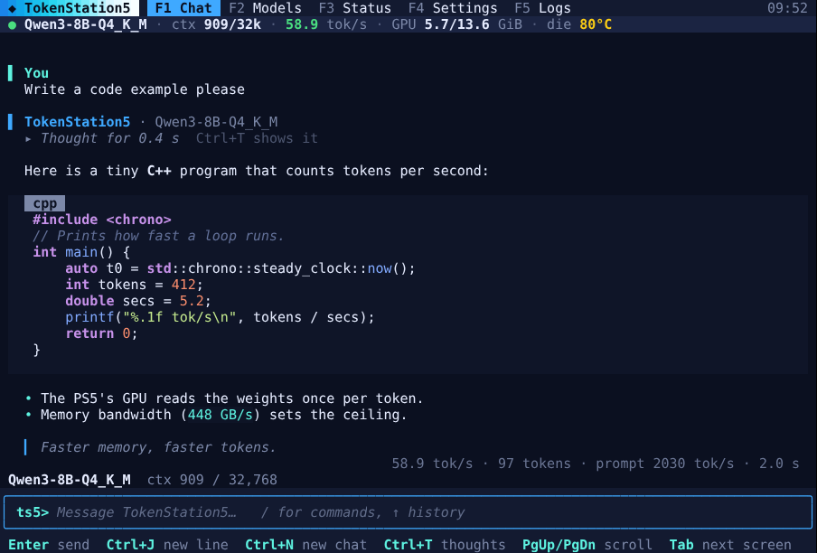
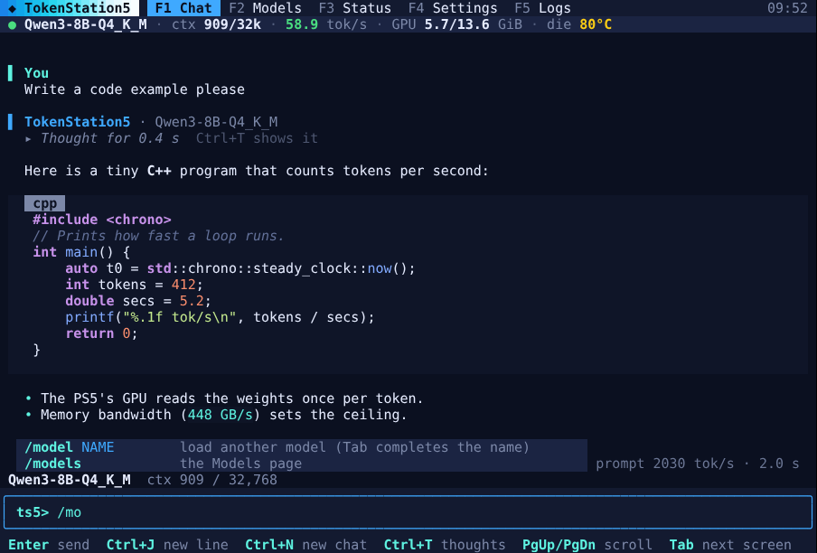
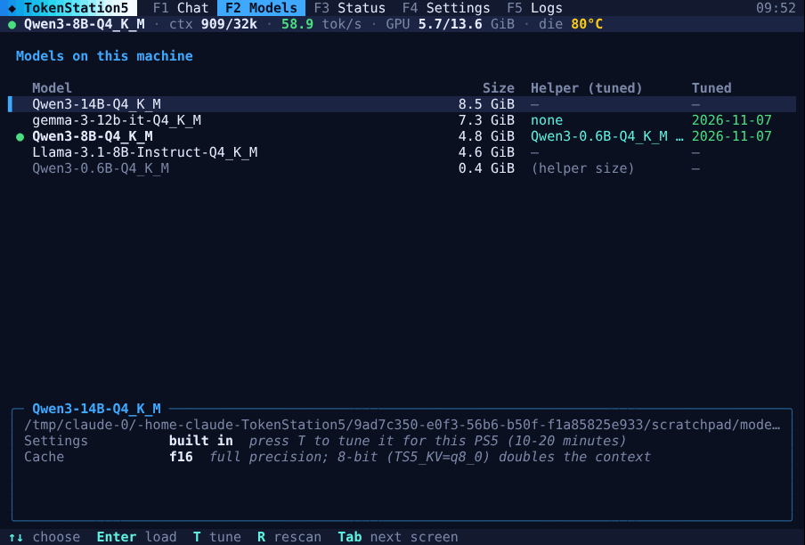
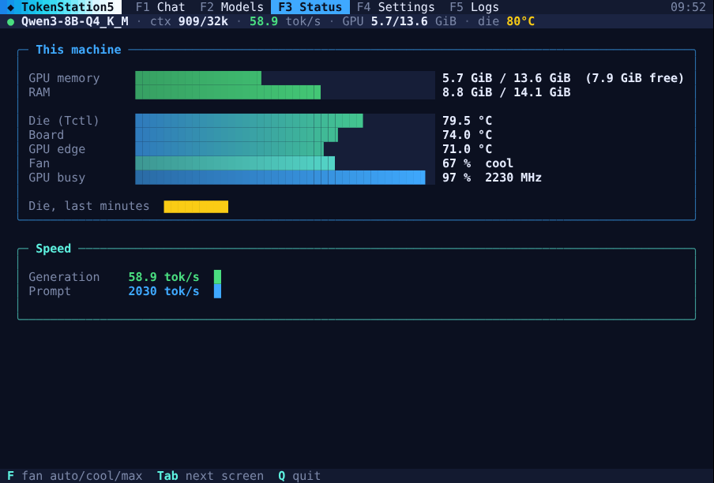

# Using the terminal app (ts5-tui)

`ts5-tui` is TokenStation5 in a terminal: a colorful, keyboard-driven app for when you SSH into the PS5, or sit at its text console. It chats with the loaded model, switches and tunes models, and shows the PS5's GPU memory, temperatures and fan live. Linux edition only.



It is a client of TokenStation's own API (port 8081), like any other app. It loads nothing itself and uses no GPU memory, so it can run beside the TV app or the API-only service.

> **Availability:** ts5-tui is in [pull request #112](https://github.com/ThatRetiredDude/TokenStation5/pull/112) and comes with the Linux packages once that is merged (`/usr/bin/ts5-tui`, or `~/.local/bin/ts5-tui` with the portable build). Until then, build it from the pull request on the PS5. It needs only a C++ compiler (`sudo apt install g++ git`) and takes a few seconds:
>
> ```sh
> git clone --depth 1 https://github.com/ThatRetiredDude/TokenStation5 ts5-tui-src
> cd ts5-tui-src
> git fetch --depth 1 origin pull/112/head && git checkout FETCH_HEAD
> c++ -std=c++17 -O2 -I engine/src -I linux/tui linux/tui/*.cpp -o ts5-tui -pthread
> sudo install -m 755 ts5-tui /usr/local/bin/
> ```
>
> Loading a model with Enter through the API-only service also needs that pull request's version of the `hw` helper, which comes with the package.

## Start it

From your computer, SSH into the PS5, then run `ts5-tui`:

```sh
ssh ps5@<your PS5's address>
ts5-tui
```

The TokenStation title sweeps in for about a second (any key skips it), and you land in Chat.

| Command | What it does |
| --- | --- |
| `ts5-tui` | Talks to the server on this machine (`http://127.0.0.1:8081`). |
| `ts5-tui --url http://ps5.local:8081` | Talks to another TokenStation (`ps5.local` alone works too: http and port 8081 are assumed). |
| `ts5-tui --key KEY` | An API key, when the server asks for one (the TV app's **Require a key**). |
| `ts5-tui --theme Neon` | Colors: `Ocean` (default), `Neon`, `Sunset`, `Forest`, `Mono`. |
| `ts5-tui --no-intro` | Skips the opening title. |
| `ts5-tui --tmux` / `--no-tmux` | Forces its own tmux session on or off (see [tmux](#tmux-ssh-that-can-drop)). |

`TS5_URL` and `TS5_API_KEY` in the environment do the same as `--url` and `--key`.

Run it **on the PS5** (over SSH) for the whole experience. Pointed at a PS5 from another machine with `--url`, chat works, but the sensors, models and logs it shows are that machine's, and loading a model is refused: models are switched where they are served.

## The screen

```
 ◆ TokenStation5   F1 Chat  F2 Models  F3 Status  F4 Settings  F5 Logs        09:52   ← pages
 ● Qwen3-8B-Q4_K_M · helper Qwen3-0.6B · ctx 909/32k · 58.9 tok/s · GPU 5.7/13.6 GiB · die 80°C   ← live bar

   (chat, or the page you picked)

 Qwen3-8B-Q4_K_M  ctx 909 / 32,768
╭────────────────────────────────────────────────────────────────────────╮
│ ts5> your message                                                      │   ← the prompt
╰────────────────────────────────────────────────────────────────────────╯
 Enter send  Ctrl+J new line  Ctrl+N new chat  …                             ← keys for this page
```

**The top bar stays put** whatever you do below it:

| Item | Meaning | Colors |
| --- | --- | --- |
| ● model | What the server has loaded. | Green: ready. Yellow: no model yet. Red: the server is offline. |
| helper | The helper (draft) model `ts5-tune` chose for it, or `off`. | |
| ctx | Context used by this chat, of the model's total. | |
| tok/s | The last answer's speed: any app's when ts5-tui can read the server's log, else its own chats'. | |
| GPU | GPU memory used / total, in GiB. | Yellow under 2 GiB free, red under 1 GiB (the engine keeps 1 GiB back). |
| RAM | System memory used / total. | Same as GPU. |
| die | The chip's temperature (Tctl), the one the PS5's limiter watches. | Yellow from 78 °C, red from 83 °C. |
| fan | Fan speed. | |

On a narrow window the least needed items drop off first (fan, then RAM). When the die reaches **85 °C**, where the PS5 starts slowing its GPU, a red warning line flashes under the bar: `/fan max` helps.

**Five pages** fill the middle. Switch with **F1** to **F5**, **Tab** (next) and **Shift+Tab** (previous), or **Alt+1** to **Alt+5**. On every page but Chat, **1** to **5** switch too, **q** quits, and **/** jumps to the prompt with a command started.

## Chat (F1)

Type at `ts5>` and press **Enter**. The answer streams in with its formatting: headings, lists, quotes, and code blocks with highlighting. A thinking model's reasoning is folded away: while it thinks you see a pulsing **thinking…** line with its last words, then **▸ Thought for 4.1 s**. **Ctrl+T** unfolds every chat's thinking (and folds it again). Under each answer: its speed, tokens, prompt speed and time.

| Key | What it does |
| --- | --- |
| Enter | Send. |
| Ctrl+J or Alt+Enter | A new line in the message. Pasting several lines works too. |
| ↑ / ↓ | The messages and commands you typed before. |
| Esc | Stops an answer (Ctrl+C too). With no answer running, clears what you typed. |
| Ctrl+N | A new chat. |
| Ctrl+T | Show or hide the thinking. |
| PgUp / PgDn | Scroll the chat a page. Ctrl+↑ / Ctrl+↓ scroll a line, and so does the mouse wheel in tmux. End (with nothing typed) goes back to the bottom. |
| ← → Home End | Move in what you're typing. Ctrl+← / Ctrl+→ by word. |
| Ctrl+A / Ctrl+E | Start / end of the line. |
| Ctrl+U / Ctrl+K / Ctrl+W | Delete to the start / to the end / the word before. |
| Ctrl+Q | Quit. |

The status line over the prompt shows the model and how full the context is (yellow from 75%, red from 90%). When a chat outgrows the context, the server says so and **Ctrl+N** starts fresh.

### Commands

Type `/` and the matching commands show above the prompt. **Tab** completes the command, and after `/model` or `/tune` the model name (press Tab again to step through the matches).



| Command | What it does |
| --- | --- |
| `/model NAME` | Loads another model (see [Models](#models-f2)). Part of the name is enough. `/model` alone opens the Models page. |
| `/models` | The Models page. |
| `/new` | A new chat (`/clear` too). |
| `/save [FILE]` | Saves this chat as Markdown, thinking included. Without a file: `~/tokenstation-chat-YYYYMMDD-HHMM.md`. |
| `/find TEXT` | Scrolls to the newest message containing TEXT. |
| `/tune [NAME]` | Runs `ts5-tune` on the loaded model (or NAME), live on the Models page. |
| `/think on`, `off`, `auto` | Thinking before answering, for models that can switch it. `auto` leaves it to the model. |
| `/fan auto`, `cool`, `max` | The PS5's fan (see [PS5 hardware on Linux](PS5-hardware-on-Linux)). |
| `/theme NAME` | Colors: Ocean, Neon, Sunset, Forest, Mono. Without a name, the next one. |
| `/status`, `/settings`, `/logs` | Those pages. |
| `/help` | Every command and key, in the chat. |
| `/quit` | Leaves (`/exit` and `/q` too). The server keeps running. |

## Models (F2)



Every `.gguf` on this machine, biggest first, with its size, the helper `ts5-tune` picked for it, and the date it was tuned. **●** marks the one loaded. Below the list, the selected model's tuned settings, each with what it costs: 16- or 32-bit prompt math, the helper, the cache (f16, or 8-bit for twice the context) and, for the loaded one, its context.

| Key | What it does |
| --- | --- |
| ↑ ↓, PgUp PgDn | Choose. |
| Enter | Load it. |
| T | Tune it with `ts5-tune --models` (10 to 20 minutes). |
| R | Look for model files again. |

It looks in `/var/lib/tokenstation/models` (or the service's `MODELS_DIR`), `~/.local/share/tokenstation/models` (the desktop app's), `~/models`, and `$TS5_MODELS` if set. Files under 1.5 GiB are listed as helper size and aren't tuned.

**What Enter does** depends on what serves the API:

| Running | Enter |
| --- | --- |
| The API-only service (`tokenstation`) | Switches its model and restarts it, through the package's hardware helper. Your user must be in the `tokenstation` group (`sudo adduser $USER tokenstation`, then log in again). The model must be in the service's models folder. |
| Nothing | Starts `ts5 serve` with that model on `127.0.0.1`, with the context set in Settings (8,192 by default). It keeps serving after you quit ts5-tui, which then prints its process number; `kill` it to stop it. Its log is `~/.cache/tokenstation/tui-serve.log`. |
| The TV app (`tokenstation-tv`) | Nothing: pick the model on the TV's Models page. |
| Another program on port 8081 | Nothing: switch the model there. |

The top bar shows **loading…** with the seconds until the server reports the new model.

**Tuning** opens a pane with `ts5-tune`'s output as it runs. **Esc** hides it and tuning goes on (T shows it again), **X** stops it, PgUp/PgDn scroll. Tuning needs the GPU's memory: a `ts5 serve` that ts5-tui started is stopped for it. If the service holds a model, stop it first (`sudo systemctl stop tokenstation`). ts5-tune saves the results in your own `~/.config/tokenstation/tune/`. The API-only service runs as its own user and reads `/etc/tokenstation/tune/`, so copy the file there for the service (`sudo mkdir -p /etc/tokenstation/tune && sudo cp ~/.config/tokenstation/tune/<model>.gguf.env /etc/tokenstation/tune/`).

## Status (F3)



btop-style bars for this machine: GPU memory (with GiB free), RAM, the die (Tctl), board and GPU edge temperatures, fan (percent, rpm and mode), GPU load and clock. Below them, the die's temperature over the last minutes, and the generation and prompt speeds of recent answers: every app's when ts5-tui can read the server's log (see [Logs](#logs-f5)), else its own.

**F** steps the fan through auto, cool and max (as `/fan` does).

## Settings (F4)

**↑ ↓** choose, **← →** change, **Enter** edits a text setting (Esc cancels). Every change is saved at once, in `~/.config/tokenstation/tui.conf`.

| Setting | What it does |
| --- | --- |
| Server | The TokenStation to talk to. |
| API key | Only when the server asks for one. Kept in the settings file, readable by you only. |
| Theme | Ocean, Neon, Sunset, Forest, Mono. |
| Thinking | The model's choice, on, or off. |
| Temperature | The model's own, or 0.1 to 1.5. Lower is steadier. |
| Answer length | No limit, or a cap of 512 to 8,192 tokens. Under 1,024 turns thinking off. |
| Context (own) | The context for a model ts5-tui starts itself: 4,096 to 32,768, or auto (what fits). |
| Fan (PS5) | auto (quiet), cool (keeps long prompts under the 85 °C limiter), max (loud). |
| tmux | Its own tmux session from a plain terminal. |
| Opening title | The title at start. |

The engine's own switches (prompt math, cache, helper) are per model, and `ts5-tune` sets them: Models → **T**.

## Logs (F5)

What the engine writes, colored: errors red, warnings yellow, speed lines green. **PgUp/PgDn** and **↑ ↓** scroll, **End** follows the newest again, **Home** goes to the start.

It follows the API-only service's journal (`journalctl -u tokenstation`; reading it may need the `systemd-journal` or `adm` group), the TV app's `/var/lib/tokenstation/ts5.log`, or the log of the `ts5 serve` it started, whichever is running. `TS5_TUI_LOG=/path/to/file ts5-tui` follows a file of your choice.

## tmux: SSH that can drop

From a plain terminal (an SSH session from Terminal, iTerm, PuTTY…), ts5-tui starts itself inside its own **tmux** session, called `ts5`, when tmux is installed (the packages recommend it). If the connection drops, nothing stops: the answer finishes, the model keeps loading, tuning goes on. Run `ts5-tui` again and you're back where you were.

- **Ctrl+A** then **D** leaves it running in the background; `ts5-tui` comes back to it.
- The mouse wheel scrolls the chat. To select text with the mouse, hold **Shift** (Option on a Mac in iTerm).
- It uses its own tmux server and settings (`~/.cache/tokenstation/tmux.conf`): your `~/.tmux.conf` and your other tmux sessions are left alone, and tmux's own status bar is hidden.
- Quitting ts5-tui ends the session.

In an **IDE's terminal** (VS Code, Cursor, JetBrains, including their Remote-SSH) tmux stays off, because the IDE keeps its terminals alive itself and its shortcuts would clash. `--tmux` turns it on there anyway, and `--no-tmux` or Settings → tmux turns it off everywhere.

> **Plain SSH leaves more memory for models.** An IDE's Remote-SSH server runs on the PS5 and takes memory the GPU could use (Cursor's took 4.7 to 6.5 GB). For coding, run the IDE on your computer and point it at the PS5's API instead ([Connecting apps](Connecting-apps)).

## When you quit

**Ctrl+Q**, `/quit`, or **q** on a page other than Chat. The chat is printed into your terminal, so it stays in its scrollback (also after a tmux session). The server and its model keep running.

## If something's off

| What you see | Why, and what to do |
| --- | --- |
| **● offline** in the top bar | Nothing answers at the address. Start the service (`sudo systemctl start tokenstation`) or the TV app, or load a model on the Models page, which starts `ts5 serve`. Check the address in Settings. |
| **needs an API key** | The server has **Require a key** on: put a key in Settings → API key, or start with `--key`. |
| No temperatures, fan or GPU memory | ts5-tui isn't running on the PS5 (a Mac, or `--url` to another machine), or the PS5 kernel's sensors are missing. Run it over SSH on the PS5. |
| Load or fan: "needs the tokenstation group" | `sudo adduser $USER tokenstation`, then log out and in. |
| Colors look washed out or wrong | The terminal has no 24-bit color, so ts5-tui uses 256 colors. Terminals that support it set `COLORTERM=truecolor`; try another theme, or `Mono`. |
| Odd characters instead of boxes | The terminal isn't UTF-8. Set a UTF-8 locale (`export LANG=C.UTF-8`). |
| tmux opens when you don't want it | `ts5-tui --no-tmux`, or Settings → tmux → off. |

More in [Troubleshooting](Troubleshooting).
